<p align="center">
  
</p>

<p align="center">
  <a href="https://www.linkedin.com/in/wagnerpessoadev/"></a>
  <a href="https://wagnerpessoa.me"></a>
  <a href="https://www.instagram.com/wagnerpessoadev/"></a>
  <a href="mailto:wagnerpessoa.dev@gmail.com"></a>
  
  
  
</p>

<br />


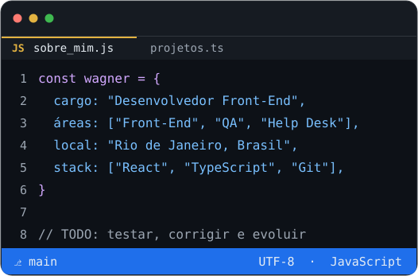


Sou do **Rio de Janeiro** e atuo com **desenvolvimento Front-End**, **QA** e **Help Desk**. Uso o GitHub como caderno de estudos para acompanhar minha evolução em tecnologia.

Aqui compartilho exercícios de lógica e programação e projetos web que desenvolvo para praticar o que aprendo.

```diff
+ Desenvolvimento de interfaces web
+ Testes e qualidade de software
+ Suporte técnico
```

<br clear="right" />
<br />

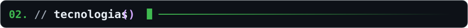

<p align="center">
  
</p>

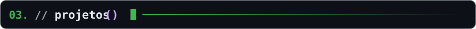

<p align="center">
  <a href="https://github.com/WagnerPessoaDEV/CuidarBem">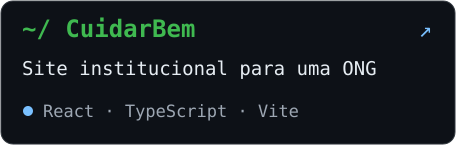</a>
  <a href="https://github.com/WagnerPessoaDEV/Marca.AI">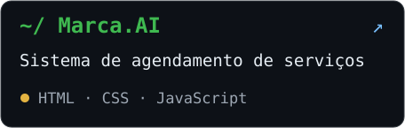</a>
</p>

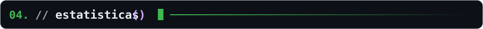

<p align="center">
  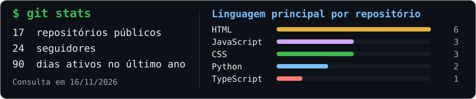
</p>

<p align="center">
  
</p>

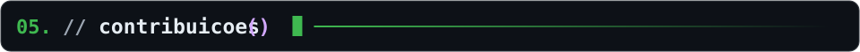

<p align="center">
  <a href="https://github.com/WagnerPessoaDEV">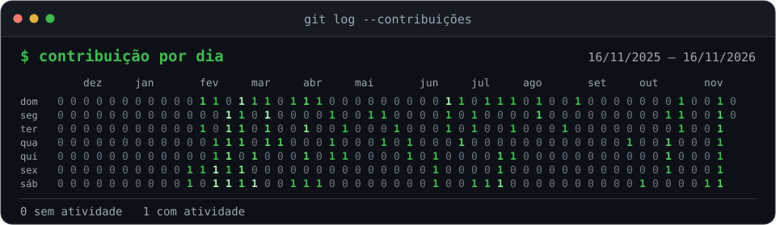</a>
</p>

